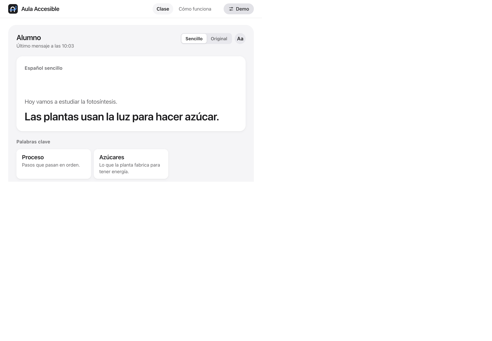

# Aula Accesible v2

Prototipo frontend para que un alumno sordo siga la clase con subtítulos en español sencillo, palabras clave y respuestas rápidas. **Demo en vivo:** [URL_DEMO]



## El problema y la solución

En una clase, un alumno sordo puede perder información cuando la explicación solo se da de forma oral.
Aula Accesible reúne en una pantalla lo que dice el maestro y una forma sencilla de responder.
El alumno puede leer subtítulos simplificados, consultar palabras clave y enviar respuestas rápidas.
Es un prototipo: no sustituye a un intérprete ni a una herramienta de accesibilidad validada.

## Qué incluye

- **Subtítulos:** el maestro escribe o dicta; el alumno puede elegir texto sencillo u original y aumentar su tamaño.
- **Palabras clave:** definiciones breves para el vocabulario de la explicación.
- **Respuestas:** opciones rápidas y un campo de texto para el alumno.
- **Demo simulada:** clase de ejemplo, dictado, respuesta con señas, fallos de simplificación y estados de conexión.
- **Experimental:** reconocimiento de un conjunto reducido de respuestas con señas y animación opcional del backend. No son traducción validada de Lengua de Señas Mexicana (LSM).

La demo funciona sin backend con `DEMO_MODE: true`. En ese modo, las funciones señaladas como simuladas no procesan voz ni video reales.

## Ejecutar y compilar

Se necesita Python 3 para servir el sitio localmente:

```bash
python3 -m http.server 8000
```

Abre <http://localhost:8000>. No abras `index.html` con `file://`: la app usa módulos ES. Para usar micrófono o cámara, el navegador requiere `localhost` o HTTPS y permiso del usuario.

Para compilar Sass, instala Dart Sass si aún no está disponible y ejecuta:

```bash
npm install --global sass
sass scss/main.scss css/main.css
```

`css/main.css` es el archivo compilado que carga la página; los cambios visuales se hacen en `scss/`.

## Estructura y convenciones

```text
index.html, fuentes.html   Pantalla de clase y explicación del prototipo
assets/img/                Logos e ícono
css/main.css               CSS generado por Sass
LICENSE                    Licencia Apache-2.0
scss/                      Tokens, base, layout y componentes
js/
  main.js                  Arranque y eventos globales
  state.js                 Store y estado
  controller.js            Acciones y coordinación de servicios
  selectors.js             Valores derivados del estado
  data/                    Respuestas y datos de demo
  services/                API, cámara, dictado y simulaciones
  ui/                      Renderizado por área de interfaz
docs/captura.png           Captura de la demo
```

El CSS sigue **BEM** (`bloque__elemento--modificador`). Los atributos `data-*` conectan HTML y JavaScript; los estados accesibles se expresan con atributos como `aria-pressed`, `aria-current` y `hidden`. El flujo principal es **evento → controller → store → ui**, con `selectors` para derivar lo que se muestra.

## Conexión con backend

`js/config.js` deja `DEMO_MODE: true` por defecto. Para conectar servicios, configura `DEMO_MODE: false`, `API_URL` y, si se habilita el laboratorio experimental, `RECOGNITION_WS_URL`. No incluyas llaves de API en el frontend.

- **`POST /simplificar`** recibe `{ "texto": "..." }` y puede responder con `texto_sencillo`, `palabras_clave` (cada una con `palabra` y `definicion`) y `animacion_url` opcional.
- **WebSocket de señas:** el navegador envía cuadros JPEG al servicio configurado. El contrato de eventos contempla `manos`, `parcial`, `final` y `no_reconocido`. Solo se busca reconocer respuestas rápidas; la animación y el reconocimiento son experimentales y no constituyen una traducción validada.

El contrato es una interfaz propuesta para integrar el frontend; el backend debe confirmar rutas, formatos, CORS y manejo de datos antes de habilitar producción.

## Accesibilidad y privacidad

Hay etiquetas para los campos, controles operables por teclado, foco visible, anuncios `aria-live`, opción de texto grande y soporte para `prefers-reduced-motion`. Los tokens de color y sus contrastes documentados están en `scss/abstracts/_tokens.scss`. El prototipo no es una certificación de conformidad WCAG.

En modo demo no se necesita backend y la conversación permanece en memoria del navegador; se pierde al recargar. El micrófono y la cámara requieren permiso. Al conectar el reconocimiento, los cuadros JPEG se envían al WebSocket configurado; el frontend no define la retención del servidor, que debe aclararse con el equipo responsable.

## Equipo y autoría

- **Jonathan Martínez** — diseño UX/UI y frontend.
- **Créditos:** equipo de backend e IA por la colaboración en el prototipo.
- GitHub: [jonnschenk](https://github.com/jonnschenk)

## Licencia

Este proyecto se distribuye bajo la licencia [Apache-2.0](LICENSE).
